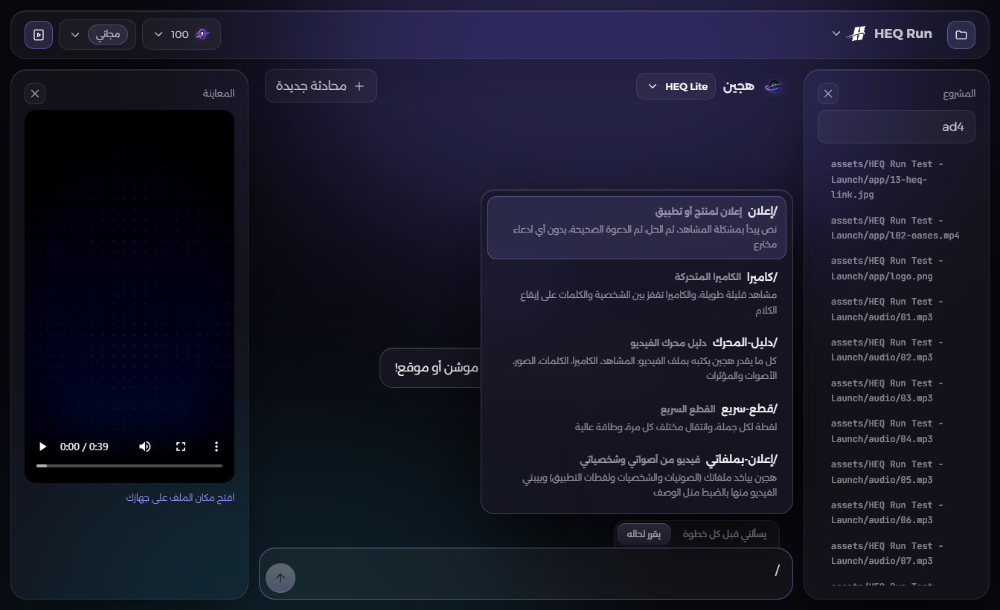
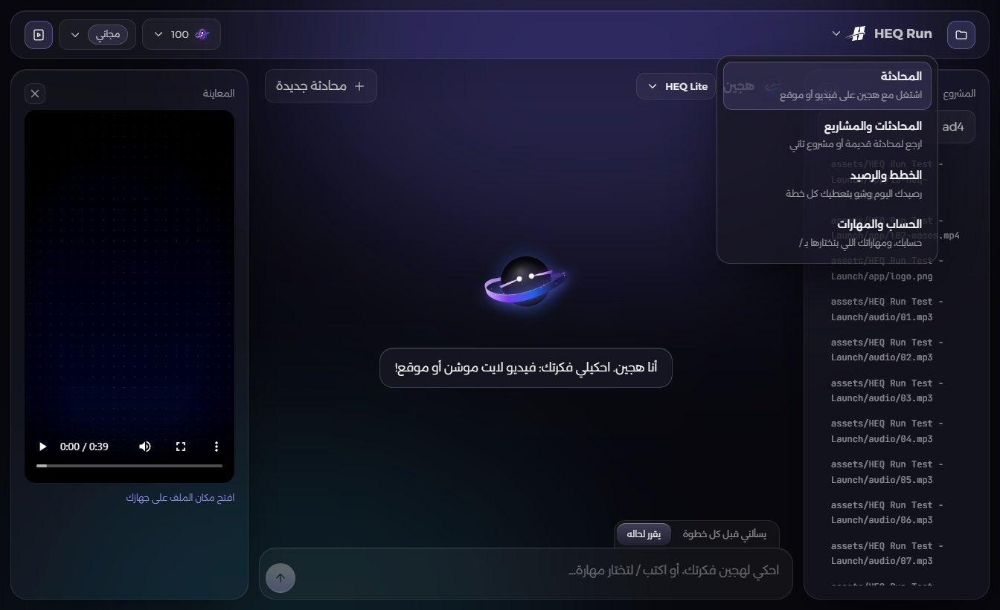

  

<h1 align="center">HEQ Run Desktop</h1>

  <b>هجين بيعمل فيديوهاتك ومواقعك على جهازك</b> 
  Hajeen makes your videos and websites, on your own computer

  <a href="https://github.com/HuzhaifaEqbal/HEQ-Run-Desktop/releases/latest/download/HEQ-Run-Setup.exe"><b>⬇ تنزيل لويندوز · Download for Windows</b></a>
  &nbsp;·&nbsp;
  <a href="https://heq-run-6hf7.onrender.com">الموقع · Website</a>
  &nbsp;·&nbsp;
  <a href="#english">English</a>

## شو هو HEQ Run Desktop؟

HEQ Run Desktop هو تطبيق لويندوز، وجواته **هجين**: مساعد بتحكيله فكرتك بلهجتك، وهو بيشتغل عليها خطوة بخطوة لحد ما يطلعلك فيديو عمودي جاهز للنشر، أو موقع كامل.

الفرق عن أدوات الفيديو العادية إنك ما بتسحب وتحط بإيدك. إنت بتحكي شو بدك، وهجين:
- بيقرا ملفاتك.
- بيكتب النص أو بيمشي على نصك حرفياً.
- بيعمل خطة وبيعرضها عليك.
- بيبني المشاهد، وبيشيّك على اللقطات.
- بيرندر الفيديو **على جهازك**.

وكل خطوة بتشوفها بالمحادثة وهي عم تصير.

## شو بيفيد صنّاع المحتوى؟

- **فيديو من ملفاتك إنت:** أصواتك المسجلة، وشخصياتك، ولقطات شاشة تطبيقك، ولوغوك. هجين ما بيبدّلهم بشي من عنده.
- **كلام وصورة متزامنين:** بيقيس كل تسجيل صوتي، وبيطلّع كل كلمة بلحظة ما تنقال، وبيقصّر السكتات الطويلة.
- **كاميرا حية:** زوم، وميلان، ونطّات بين الشخصيات مربوطة بالكلام، مع مؤثرات صوتية قصيرة (ضربة، ووووش، تيك).
- **ما في شي فوق شي:** قبل الرندر بيفحص الإطارات، وإذا في كلمة مقصوصة أو صورتين فوق بعض، بيصلّحها لحاله.
- **الرندر على جهازك:** ملفاتك ما بتطلع من جهازك لترندر.
- **مواقع كمان:** صفحة لمطعمك أو مشروعك، بتشوفها جوّا التطبيق قبل ما تنشرها.
- **بيحكي لهجتك:** إذا كتبتله بالشامي بيرد بالشامي، وبالخليجي بيرد بالخليجي، وهكذا.

## كيف بتشتغل معه؟

### 1. نزّل وثبّت
- نزّل [`HEQ-Run-Setup.exe`](https://github.com/HuzhaifaEqbal/HEQ-Run-Desktop/releases/latest/download/HEQ-Run-Setup.exe) وشغّله.
- ويندوز ممكن يطلعلك شاشة زرقا، لأن التطبيق لسا ما عليه توقيع رقمي. اكبس **More info** وبعدين **Run anyway**.
- ادخل بنفس حسابك على [موقع HEQ Run](https://heq-run-6hf7.onrender.com). التطبيق بيفتحلك صفحة الدخول بالمتصفح وبيرجع لحاله.

### 2. جهّز ملفاتك (أهم خطوة)
كل ما كانت ملفاتك مرتبة، كل ما طلع الفيديو أقرب للي ببالك:

| الملف | كيف بيكون أحسن |
|---|---|
| الصوتيات | تسجيل واحد لكل جملة، مرقّمة بالترتيب: `01.mp3`، `02.mp3` … |
| الشخصيات | صور PNG مقصوصة بدون خلفية، وبكل وضعية اسم: `sami-6.png`، `omar-5.png` |
| لقطات التطبيق | صور شاشة أو فيديوهات قصيرة: `13-login.jpg`، `l02-demo.mp4` |
| اللوغو | PNG بدون خلفية |

حطهم كلهم بمجلد واحد، وقل لهجين وين هو، وهو بينسخهم لجوّا المشروع.

### 3. اكتب وصف (سكربت) واضح
هجين بيمشي على وصفك **حرفياً**. أحسن وصف بيكون جدول، كل سطر فيه:
- مين بيحكي.
- النص بالضبط.
- ملف الصوت.
- وضعية الشخصية.
- الكلمات اللي بدك ياها كبيرة ومضيئة.

مثال:

| رقم | مين | النص | شو بيصير |
|---|---|---|---|
| 01 | سامي | يا زلمة… نزل! | `sami-6`، و«نزل!» ضخمة ومضيئة |
| 02 | عمر | شو اللي نزل؟ | الكاميرا لعند `omar-5`، والنص على شريط |
| 03 | سامي | التطبيق اللي حكيتلك عنه… | لقطة `13-login.jpg` ونقرة على الزر |

وإذا ما عندك سكربت، احكيله الفكرة بس، وهو بيكتبلك نص وبيعرضه عليك قبل ما يكمّل.

### 4. خطة قبل الفيديو
قبل ما يبني أي شي، هجين بيعرض عليك خطة: المشاهد، ومين بيحكي، وشو بيبيّن بكل لحظة. إنت بتوافق أو بتعدّل، وبعدين بيكمّل.

فوق مربع الكتابة في مفتاح بيحدد طريقة الشغل:
- **يسألني قبل كل خطوة:** بيوقف ويسألك عند كل قرار. منيح لأول مرة، أو لفيديو مهم.
- **يقرر لحاله:** بياخد الوصف وبيكمّل للآخر بدون ما يوقف. منيح لما يكون وصفك كامل.

### 5. الفحص والرندر
- قبل الرندر، هجين بيشوف إطارات من الفيديو وبيصلّح أي شي فوق بعضه أو مقصوص.
- بعدين بيرندر على جهازك، وبيطلع الفيديو بلوحة المعاينة، وبيضل محفوظ بمجلد `renders` جوّا مشروعك.
- **شو لازم تشيّك إنت:** توقيت الكلمات مع الصوت، وعلو المؤثرات. هدول بيتسمعوا بالأذن، وهجين بيقلك إذا في سطر توقيته تقديري.

## المهارات ( / ): ليش وكيف؟

المهارة هي **طريقة شغل محفوظة**: تعليمات بتقول لهجين كيف يعمل نوع معين من الفيديوهات، فما بتضطر تعيد شرحها كل مرة.

**كيف بتستعملها:** اكتب `/` بمربع الكتابة، واختار مهارة، وبعدين اكتب طلبك عادي.

**المهارات اللي جاية مع التطبيق:**

| المهارة | شو بتعمل |
|---|---|
| `/إعلان-بملفاتي` | فيديو من أصواتك وشخصياتك ولقطاتك، بالضبط متل وصفك |
| `/إعلان` | إعلان لمنتج أو تطبيق: المشكلة، بعدين الحل، بعدين الدعوة |
| `/كاميرا` | مشاهد قليلة طويلة، والكاميرا بتنطّ بين الشخصيات على إيقاع الكلام |
| `/قطع-سريع` | لقطة لكل جملة وانتقال مختلف كل مرة، بطاقة عالية |
| `/دليل-المحرك` | كل شي بيقدر المحرك يعمله، لما بدك تحكم بالتفاصيل |

**ليش تعمل مهاراتك الخاصة؟** إذا عندك ستايل ثابت لقناتك، مثلاً «كل فيديو بيبلش بسؤال، والألوان كحلي وذهبي، وبيخلص باسم الصفحة»، احفظه كمهارة مرة وحدة، وكل فيديوهاتك بتطلع بنفس الهوية.

**كيف تضيف مهارة:**
- من **قائمة اللوغو ← الحساب والمهارات ← مهارة جديدة**: اكتب اسمها وشو بتعمل وتعليماتها.
- أو من المحادثة: بعد فيديو عجبك، قل لهجين **«احفظ هالطريقة كمهارة»**.
- وفيك تعدّل نسخة إلك من أي مهارة جاية مع التطبيق.
- المهارات بتنحفظ كملفات نص بمجلد `Documents\HEQ Run\مهارات`، فبتقدر تشاركها مع فريقك.

## الموديلات والخطط
- **HEQ Lite:** سريع، ومتاح لكل الخطط.
- **HEQ Ultra:** أقوى بالتفكير والفيديوهات الطويلة، وللخطط المدفوعة بس.
- رصيدك وذاكرة المحادثة بيبيّنوا فوق بالتطبيق، والخطط على [الموقع](https://heq-run-6hf7.onrender.com).
- الخطة المجانية بيطلع فيديوها مع علامة HEQ Run المائية.

## كل شي بمكانه

- **قائمة اللوغو:** المحادثة، والمحادثات والمشاريع، والخطط والرصيد، والحساب والمهارات.
- **المحادثات والمشاريع:** كل محادثة بتنحفظ جوّا مشروعها، وبترجعلها وبتكمّل من وين وقفت.
- **لوحة المشروع ولوحة المعاينة:** بتسكّرهم لما بدك مساحة أكبر للمحادثة.

## الخصوصية
- ملفاتك بتضل على جهازك، والرندر بيصير على جهازك.
- هجين بيبعت للسيرفر بس الشي اللي بيشتغل عليه: رسائلك، والنصوص اللي بيقراها من مشروعك، وصور صغيرة من الإطارات وقت الفحص.
- التسجيلات الصوتية بتنقاس على جهازك وما بتنبعت.

## المتطلبات
- ويندوز 10 أو 11 (64 بت).
- إنترنت للمحادثة مع هجين. الرندر ما بيحتاج إنترنت.
- حساب على [HEQ Run](https://heq-run-6hf7.onrender.com).

## مشكلة أو اقتراح؟
افتح [Issue](https://github.com/HuzhaifaEqbal/HEQ-Run-Desktop/issues) واحكيلنا شو صار. وإذا في رسالة خطأ بالمحادثة، انسخها معك.

---

## English

### What is it?
HEQ Run Desktop is a Windows app with **Hajeen** inside: an assistant you talk to in your own words. It works through your idea step by step until you have a vertical video ready to post, or a complete website. You don't drag and drop anything. You say what you want, and Hajeen does the rest, showing each step in the chat as it happens:
- reads your files;
- writes a script, or follows yours word for word;
- shows you a plan;
- builds the scenes and checks the frames;
- renders **on your computer**.

### Why creators use it
- **Built from your own files:** your voice recordings, your characters, your app screenshots and your logo. Hajeen never swaps them for its own.
- **Words in sync with the voice:** it measures every recording, lands each word as it is spoken, and trims long pauses.
- **A living camera:** zooms, tilts and hops between speakers, tied to the words, with short sound effects.
- **Nothing on top of anything:** before rendering it looks at frames and fixes cut-off words or overlapping pictures.
- **Local render:** your files never leave your computer to be rendered.
- **Websites too:** a page for your shop or project, previewed inside the app.
- **Speaks your dialect:** it answers in the way you write.

### How to work with it
1. **Install:** download [`HEQ-Run-Setup.exe`](https://github.com/HuzhaifaEqbal/HEQ-Run-Desktop/releases/latest/download/HEQ-Run-Setup.exe). The app is not code-signed yet, so Windows may show a blue screen: choose **More info**, then **Run anyway**. Sign in with your [HEQ Run](https://heq-run-6hf7.onrender.com) account.
2. **Prepare your files:**
   - one recording per line, numbered (`01.mp3`, `02.mp3`);
   - cut-out PNG characters named by pose (`sami-6.png`);
   - screenshots or short clips;
   - a transparent logo.

   Put them in one folder and tell Hajeen where it is.
3. **Write a clear brief:** a table where each line says who speaks, the exact words, the recording, the pose, and the words to make big and glowing. No script? Describe the idea and Hajeen writes one for you to approve.
4. **Plan first:** Hajeen shows a plan before building. The switch above the input sets how it works:
   - **Ask before each step:** it stops at every decision.
   - **Decide on its own:** it runs the whole brief without stopping.
5. **Check and render:** it checks frames, renders locally, and saves the video in your project's `renders` folder. Timing and effect volume are for your ears to judge, and Hajeen tells you which lines have estimated timing.

### Skills ( / )
A skill is a **saved way of working**: instructions that tell Hajeen how to make a certain kind of video, so you don't explain it every time. Type `/` in the input and pick one.

Built in:

| Skill | What it does |
|---|---|
| `/إعلان-بملفاتي` (video from my files) | Builds exactly your brief from your own recordings, characters and screenshots |
| `/إعلان` (ad) | A product or app ad: problem, then solution, then call to action |
| `/كاميرا` (camera) | A few long shots, with the camera hopping between speakers |
| `/قطع-سريع` (fast cut) | A new shot for every line, with high energy |
| `/دليل-المحرك` (engine guide) | Everything the engine can do, for full control |

Make your own so every video on your channel keeps one identity:
- From **Logo menu → Account & skills → New skill**.
- Or after a video you like, tell Hajeen **"save this as a skill"**.

Skills are plain text files in `Documents\HEQ Run\مهارات`, so you can share them with your team.

### Models and plans
- **HEQ Lite:** fast, on every plan.
- **HEQ Ultra:** stronger reasoning for long videos, on paid plans.
- Free-plan videos carry the HEQ Run watermark.

### Privacy
- Your files stay on your computer, and rendering happens there.
- Hajeen sends only what it works on: your messages, the text it reads from your project, and small frames while checking.
- Voice recordings are measured locally and never uploaded.

### Requirements
- Windows 10 or 11 (64-bit).
- Internet for the chat. Rendering works offline.
- An [HEQ Run](https://heq-run-6hf7.onrender.com) account.

### Feedback
Open an [issue](https://github.com/HuzhaifaEqbal/HEQ-Run-Desktop/issues) and paste any error message from the chat.

---

© HEQ · HEQ Run

