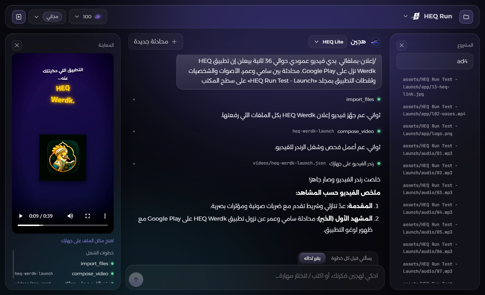
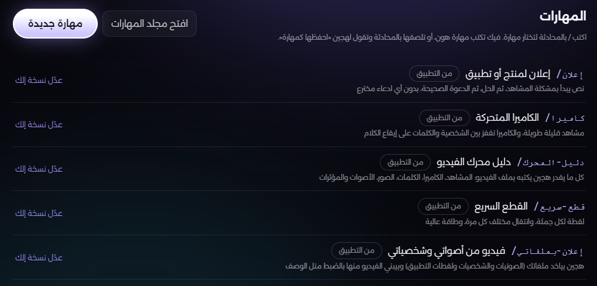
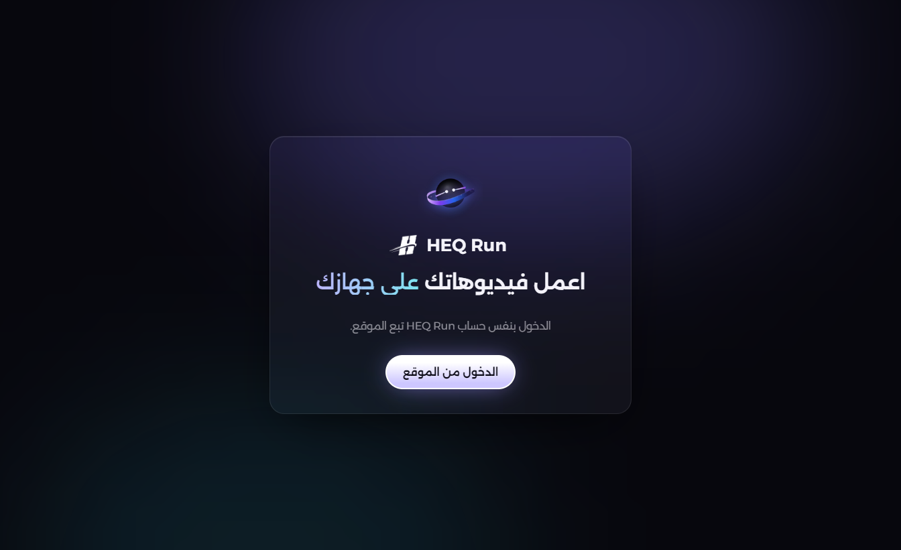

  

<h1 align="center">HEQ Run Desktop</h1>

  <b>مساحة عمل ذكية تجمع الوكيل «هجين» للبرمجة والطرفية والمتصفح وصناعة المواقع والفيديو — مباشرة على جهازك</b> 
  Your all-in-one local workspace powered by Hajeen — for coding, terminal workflows, built-in browsing, websites, and vertical videos on your own computer.

  <a href="https://github.com/HuzhaifaEqbal/HEQ-Run-Desktop/releases/latest/download/HEQ-Run-Setup.exe"><b>⬇ تنزيل الإصدار v0.4.3 لويندوز · Download v0.4.3 for Windows</b></a>
  &nbsp;·&nbsp;
  <a href="https://heq-run-6hf7.onrender.com">الموقع · Website</a>
  &nbsp;·&nbsp;
  <a href="#english">English</a>

---

## ما هو HEQ Run Desktop؟

**HEQ Run Desktop** هو تطبيق سطح مكتب لنظام ويندوز يضع بين يديك الوكيل الذكي **«هجين»** ليعمل مباشرة داخل مجلد مشروعك على جهازك.

بدلاً من التنقّل بين عدة أدوات منفصلة، يمكنك وصف ما تريده بلغتك الطبيعية أو بالصوت أو بإرفاق صور وملفات، وسيتولى **هجين** تنفيذ المهمة خطوة بخطوة أمامك بشفافية كاملة:

- **البرمجة وتعديل المشاريع:** يقرأ بنية مشروعك، يبحث داخل الملفات، يكتب الكود ويعدّله مع عرض الفروقات وحفظ نقاط استعادة تلقائية.
- **طرفية تفاعلية مدمجة:** يشغّل الأوامر والاختبارات محلياً داخل مجلد مشروعك مع إمكانية تشغيل الأوامر يدوياً أو بضغطة واحدة.
- **متصفح مدمج داخل التطبيق:** يعرض صفحات الويب بملء الارتفاع ويتيح لهجين فحصها والتفاعل معها أمامك مع إمكانية تولّيك التحكم في أي لحظة.
- **صناعة فيديوهات الموشن والمواقع:** ينشئ مواقع كاملة وفيديوهات عمودية (`9:16`) من ملفاتك وأصواتك وشخصياتك، ويفحص الإطارات قبل التصدير، ثم يصدّر الفيديو مباشرة على جهازك.
- **التفاعل الصوتي وإرفاق الصور والفيديو:** تحدّث مباشرة عبر الميكروفون، واستمع لردود هجين صوتياً، وأرفق الصور أو ملفات المشروع أو مقاطع الفيديو — حيث يقوم التطبيق بقصّ لقطات مفتاحية من الفيديو محلياً على جهازك ليقرأها هجين ويحلّلها.
- **المهارات المخصّصة (`/`):** احفظ أسلوب عملك المفضل كمهارة جاهزة وأعد استخدامها في أي مشروع بكتابة `/` داخل حقل الإرسال.
- **التكامل مع منظومة HEQ Link:** مزامنة تلقائية للباقة والرصيد، وإمكانية نشر أعمالك ومقاطعك مباشرة عبر حسابك المرتبط.

## المهارات المخصّصة (`/`)

المهارة هي أسلوب عمل محفوظ تختاره بكتابة `/` في حقل الإرسال لتطبيق نفس الهوية والتعليمات على أي مشروع أو فيديو دون إعادة الشرح في كل مرة، كما يمكنك إنشاء مهاراتك الخاصة وتعديلها من إعدادات الحساب.

## جديد الإصدار v0.4.3

- **شعار هجين العائم والنابض بالصوت:** عند استماعك لردود هجين صوتياً يظهر شعاره العائم نابضاً مع ذبذبات الصوت الحية، ويمكنك سحبه وتحريكه بحرية لأي مكان على الشاشة.
- **نطق صوتي متدفّق فائق السرعة + تفريغ صوتي محلي:** بدء نطق الجملة الأولى فوراً أثناء تحضير باقي الجمل في الخلفية، مع دعم التشغيل المحلي لنموذج التفريغ الصوتي وتخصيص مسار مستقل للصوت.
- **أيقونات سفلية نظيفة وحالة تنفيذ دقيقة للطرفية:** أزرار أيقونات أنيقة للاستماع والنسخ في نهاية كل رد، مع عرض واضح لنجاح أو فشل كل أمر طرفية ودعم المعاملات المركّبة على ويندوز.
- **إرسال الفيديوهات وقص اللقطات محلياً على جهازك:** أرفق أو اسحب أي ملف فيديو إلى المحادثة، أو اطلب من هجين فحص فيديو داخل مشروعك، ليقوم التطبيق بقصّ لقطات مفتاحية محلياً على حاسوبك وقراءتها وتحليلها دون إثقال الخادم.
- **واجهة زجاجية هادئة (أسود داكن / أبيض فاتح):** تصميم نظيف وبسيط بلا كروت زائدة في المحادثة، مع إمكانية التبديل بين المظهر الداكن والفاتح من إعدادات الحساب.
- **معاينة متناسقة ومرنة:** معاينة فيديو عمودية (`9:16`) بحجم رشيق متناسق، ومعاينة متصفح بملء الارتفاع بدون فراغات، مع إمكانية سحب وتغيير عرض الأعمدة لتناسب أي حجم شاشة.

## مستويات الأداء داخل التطبيق

يمكنك اختيار المستوى الأنسب لمهمتك مباشرة من حقل الإرسال:

| المستوى | الوصف |
|---|---|
| **HEQ Auto** | يختار تلقائياً التوازن الأنسب بين السرعة والعمق حسب صعوبة المهمة |
| **HEQ Pro** | تفكير عميق للبرمجة المعقدة، التخطيط المعماري، وأوامر الطرفية |
| **HEQ Hybrid** | قدرة هجينة متقدمة للمشاريع الثقيلة والمراجعة الدقيقة |
| **HEQ Lite** | استجابة سريعة واقتصادية للأسئلة والتعديلات الخفيفة |

كما يمكنك اختيار وضع التنفيذ المناسب لك:
- **تخطيط فقط:** يعرض الخطة والمقترحات دون تعديل ملفاتك.
- **موافقة ذكية:** يطلب موافقتك قبل تشغيل الأوامر الحساسة.
- **تلقائي:** ينفّذ الخطوات بسلاسة ومتابعة مباشرة.

## كيفية البدء خلال دقيقة

1. نزّل مثبّت ويندوز [`HEQ-Run-Setup.exe`](https://github.com/HuzhaifaEqbal/HEQ-Run-Desktop/releases/latest/download/HEQ-Run-Setup.exe) وشغّله.
2. في حال ظهور تنبيه حماية ويندوز (لأن التطبيق قيد التوقيع الرقمي)، اختر **More info** ثم **Run anyway**.
3. سجّل الدخول بحسابك على [موقع HEQ Run](https://heq-run-6hf7.onrender.com) — سيفتح المتصفح لتأكيد الدخول ثم يعود بك إلى التطبيق تلقائياً.
4. اختر مجلد مشروعك من جهازك وابدأ العمل مع **هجين** فوراً.

## الخصوصية والتشغيل المحلي

- جميع ملفات مشروعك، أوامر الطرفية، المتصفح المدمج، وتصدير الفيديو تعمل **محلياً 100% على جهازك**.
- لا تُغادر ملفات التصدير جهازك ولا تُرفع لأي خادم خارجي.
- يمكنك إيقاف أي مهمة أو سحب التحكم في المتصفح أو تعديل الإعدادات في أي لحظة.

## متطلبات التشغيل

- نظام تشغيل **Windows 10** أو **Windows 11** (64-bit).
- مساحة تخزين فارغة تقارب **1 غيغابايت**.
- اتصال بالإنترنت للتواصل مع هجين (تصدير الفيديو والعمل على الملفات محلياً على جهازك).
- حساب على [HEQ Run](https://heq-run-6hf7.onrender.com).

## الدعم والملاحظات

إذا واجهتك أي مشكلة أو لديك اقتراح لتحسين التطبيق، يمكنك فتح [ملاحظة جديدة (Issue)](https://github.com/HuzhaifaEqbal/HEQ-Run-Desktop/issues) وإرفاق وصف مختصر لما حدث.

---

## English

### What is HEQ Run Desktop?

**HEQ Run Desktop** is a Windows desktop workspace powered by **Hajeen**, an interactive assistant that works directly inside your project folder on your own computer.

Describe your goal in plain language, by voice, or by attaching images and files, and Hajeen works through it step by step in front of you:

- **Coding & Project Editing:** Reads your project structure, searches files, writes and edits code with clear diffs and automatic checkpoints.
- **Interactive Local Terminal:** Runs project commands and checks locally on your computer, plus lets you run commands manually or with a single click.
- **Built-In Browser:** Full-height web preview integrated right beside your chat so Hajeen can inspect pages while you keep full control at any time.
- **Websites & Vertical Motion Videos (`9:16`):** Builds websites and vertical videos from your own assets, audio, and visuals, checks frames before export, and renders locally on your PC.
- **Voice & Attachments:** Speak via microphone, listen to audio replies, and drag-and-drop images or files directly into the composer.
- **Custom Skills (`/`):** Save reusable workflows and invoke them anytime with `/`.
- **HEQ Link Integration:** Sync your plan and balance automatically, and publish finished work seamlessly.

### What's New in v0.4.3

- **Floating Draggable Pulsing Voice Orb:** While Hajeen speaks, a floating glowing orb pulses in real time to the audio waveform and can be dragged anywhere on screen.
- **Fast Sentence-Streaming TTS & Local STT:** Immediate first-sentence playback with background prefetching and local speech-to-text support.
- **Clean Bottom Icon Actions & Accurate Terminal Status:** Minimal bottom icon buttons for Listen & Copy, accurate pass/fail badges on terminal commands, and automatic Windows PowerShell command chaining.
- **Video Attachments with Local Frame Cutting:** Attach or drag-and-drop video files into chat (or ask Hajeen to inspect any project video); frames are extracted 100% locally on your PC so Hajeen can inspect and analyze the video visually.
- **Calm Monochrome Glass UI (Dark & Light):** Distraction-free flat canvas chat with Dark/Light theme switching inside Account Settings.
- **Clean Minimal Top Bar:** Brand menu, subtle project/chat context, and a single unified account & workspace menu.
- **Balanced & Resizable Workspace:** Compact `9:16` video preview, edge-to-edge full-height browser preview, and fluid resizable columns for any window size.
- **Built-In Interactive Terminal & One-Click Run:** Execute commands directly in the Terminal tab or click **Run in Terminal** on suggested commands.
- **Voice Input & Audio Replies:** Built-in speech-to-text microphone input and text-to-speech playback on replies.
- **Improved Reliability:** Faster, smoother execution for long tasks and video frame checks.

### Performance Tiers

| Tier | Description |
|---|---|
| **HEQ Auto** | Automatically balances speed and depth for each task |
| **HEQ Pro** | Deep reasoning for complex coding, planning, and terminal tasks |
| **HEQ Hybrid** | Enhanced capacity for heavy projects and thorough reviews |
| **HEQ Lite** | Fast and lightweight responses for quick edits and questions |

### Getting Started

1. Download [`HEQ-Run-Setup.exe`](https://github.com/HuzhaifaEqbal/HEQ-Run-Desktop/releases/latest/download/HEQ-Run-Setup.exe) and run the installer.
2. If Windows SmartScreen appears (while code-signing is pending), click **More info** → **Run anyway**.
3. Sign in with your [HEQ Run](https://heq-run-6hf7.onrender.com) account and pick a project folder on your PC to start working with Hajeen.

### Privacy & Requirements

- All file operations, terminal execution, browsing, and video rendering run **100% locally on your computer**.
- **Requirements:** Windows 10 or 11 (64-bit), ~1 GB free disk space, internet connection for Hajeen, and an [HEQ Run](https://heq-run-6hf7.onrender.com) account.

---

© HEQ · HEQ Run

